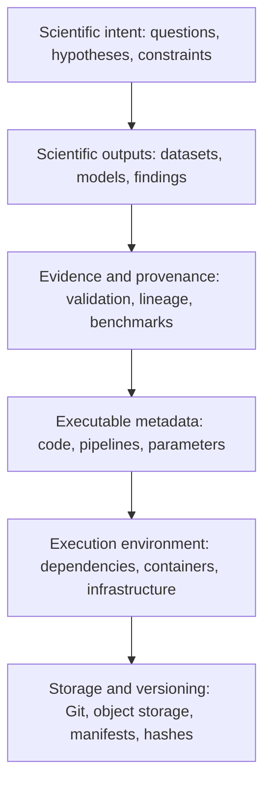

# When Code Becomes Metadata: Rethinking Research Software in the Age of AI



## Introduction

<!-- excerpt start -->
**AI assistants have made implementations cheap to produce. Validation, evidence, and long-term stewardship have not gotten cheaper.**
When writing code stops being the bottleneck, it is worth asking what the primary artifact of research software engineering really is.
Often it is not the code: it is the dataset, model, or scientific conclusion the code helps produce.
In those cases, code works like executable metadata, a description of how a result was made, and how we version and preserve it should reflect that.
<!-- excerpt end -->

This post is a follow-up to [Research Decision Engineering: Managing Cognitive Load in the Generative Era](https://bssw.io/items/research-decision-engineering-managing-cognitive-load-in-the-generative-era), which was about how engineers make decisions when AI accelerates implementation.
This one is about the artifacts: what should we preserve, maintain, and version when implementations become easy to generate?

## The Changing Economics of Code

Research software used to be expensive in a specific way.
Someone had to sit down and write every line, review it, test it, and then keep it working: answering issues, bumping dependencies, and patching it when the ecosystem moved.
The code was the scarce thing, so we built our practices around it.
We treat the repository as the project.

AI assistants change the unit cost of producing an implementation, and that change ripples outward.
Ask an assistant for a way to normalize a microscopy image and you can have three working candidates in a few minutes: one built on scikit-image, one on OpenCV, one in plain NumPy.
The outputs look similar.
They differ in speed, dependency footprint, and numerical behavior at the edges, and figuring out which difference matters is the actual work now.
Writing a candidate stopped being the hard part.
Choosing among candidates, and leaving behind evidence for why you chose one, is the hard part.

Two consequences follow.

First, more generated code does not mean more trustworthy software.
An implementation you did not carefully review carries the same scientific risk whether it took three weeks or three minutes to produce.

Second, code that was nearly free to write is not free to keep.
Issues, dependency bumps, and security patches cost the same either way.
When implementation gets cheap but maintenance does not, the ratio of value to upkeep shifts, and some code stops being worth maintaining at all.

If implementations keep getting cheaper, we should ask which artifacts actually deserve the stewardship budget.

## When Code Becomes Executable Metadata

Consider a typical image-based profiling workflow.

- Input: microscopy images of cells.
- Processing: [CellProfiler](https://github.com/CellProfiler/CellProfiler) segments the cells and extracts morphology features; [CytoTable](https://github.com/cytomining/CytoTable) harmonizes those outputs into Parquet; [Pycytominer](https://github.com/cytomining/pycytominer) aggregates and annotates the profiles.
- Output: a versioned dataset of single-cell measurements.
- Supporting information: code, parameters, model versions, dependencies, and validation results.

Where does the scientific value live?
Downstream scientists cite and build on the measurements, not the scripts.
The pipeline explains how the measurements came to be.
In that relationship, the code is metadata about the data: executable and inspectable, but supporting.
You still want it, the way you want a methods section, but the thing being published and versioned is the dataset.

This is a role, not a demotion, and it depends on what the software is for:

| Software role | Primary artifact | Role of code |
|---|---|---|
| Reusable scientific library | The implementation | Primary maintained product |
| Research analysis | Scientific results | Method and provenance |
| Data-processing pipeline | Derived dataset | Executable transformation |
| Computational experiment | Evidence and conclusions | Experimental procedure |
| Exploratory AI-generated analysis | Validated findings | Possibly temporary implementation |

The qualification matters: a scientific library, simulation engine, or numerical algorithm can itself be the research contribution.
CellProfiler is the contribution; a wrapper script around it usually is not.
The argument is about the relationship between code and scientific purpose, not about replacing software with data.

## A Layered Model of Artifacts

One way to keep this straight is to separate the layers a computational result sits on:



_Diagram showing a hierarchy of scientific artifacts from intent down to storage._

This is a hierarchy of purpose, not an execution order.
Intent defines what we are trying to learn.
Outputs carry the knowledge.
Evidence supports the interpretation.
Code and environments describe how everything was produced.
Storage and versioning preserve the relationships between all of it over time.

A few questions this model raises:

- Should a dataset reference the code that produced it? (I think yes.)
- Should a code revision reference the outputs it generated?
- Can several implementations serve the same scientific intent, with evidence that they are equivalent?
- When an implementation is replaced or regenerated, what should be kept?

## From Version Control to Knowledge Provenance

Git records changes to files over time.
A scientific result needs more than that: which input dataset versions went in, what parameters were used, which dependency versions were installed, what validation was run, and why key choices were made.
You can stuff descriptions of all this into commit messages and README files, and people do, but Git versions files.
It does not version the relationships between artifacts, and those relationships are usually what a reproducer needs.

The pieces for doing better already exist, mostly borrowed from data engineering:

- Object storage holds large, immutable artifacts that do not belong in Git.
- Content-addressed identifiers (hashes) pin the exact contents of an artifact, independent of where it lives.
- [RO-Crate](https://www.researchobject.org/ro-crate/) packages research artifacts together with a JSON-LD metadata file describing them and their relationships, building on Schema.org.
- [Workflow Run RO-Crate](https://www.researchobject.org/workflow-run-crate) extends this to workflow executions, recording what ran, with which inputs and parameters, and what came out; it is already implemented in several workflow systems (see [Recording provenance of workflow runs with RO-Crate](https://arxiv.org/abs/2312.07852) for the model, its profiles, and implementations).
- [Software Heritage](https://www.softwareheritage.org/) archives source code as a content-addressed Merkle graph and assigns it intrinsic identifiers (SWHIDs, now ISO/IEC 18670), so a precise snapshot of a repository can be referenced even if the original hosting disappears.

The point is not to replace Git with object storage.
It is that Git becomes one component in a broader system for versioning scientific knowledge.

A concrete, near-term version of this: publish the microscopy dataset in Parquet alongside a small manifest.

```yaml
artifact:
  name: single-cell-morphology-features
  version: "1.0"
  format: parquet

inputs:
  dataset: microscopy-images-v2
  identifier: "sha256:..."

implementation:
  repository: "https://github.com/example/analysis"
  revision: "abc123"
  workflow: "extract_features.py"

execution:
  environment: "container-image@sha256:..."
  parameters: "parameters.yaml"

validation:
  report: "quality-control.json"
  tests: "validation-results.json"
```

This is an illustration, not a proposed standard; if [RO-Crate](https://www.researchobject.org/ro-crate/) or another existing provenance standard fits your project, prefer it.
What the manifest changes is the center of gravity: the published dataset becomes the object that connects everything else, and the code revision is one reference among several.

## Dark Repositories

There is a related practice worth naming.
Not every public repository is an invitation to collaborate, and it would help if repositories could say so explicitly.

I will use dark repository for a repository that is publicly readable but intentionally closed to external contributions.
Its job is preservation: the implementation behind a published dataset, a completed computational experiment, an archival snapshot of an analysis.
It supports reproducibility without promising that someone will triage pull requests in 2031.

GitHub made this stance a first-class option in February 2026.
Repositories can now disable pull requests entirely, or restrict them to collaborators only, from Settings, General, Features (see the [GitHub changelog](https://github.blog/changelog/2026-02-13-new-repository-settings-for-configuring-pull-request-access) and the [documentation on disabling pull requests](https://docs.github.com/en/repositories/managing-your-repositorys-settings-and-features/enabling-features-for-your-repository/disabling-pull-requests)).
When pull requests are disabled, the tab disappears and no one can open new ones.
When restricted, anyone can view and comment, but only collaborators can create them.

Picture a research group that publishes a dataset along with the analysis code that generated it.
The analysis is finished.
The group does not intend to develop the repository into a general-purpose library, but leaving pull requests open signals, to every passerby, that contributions are welcome and will be reviewed.
Disabling them communicates the actual status more honestly than an open workflow and a silent backlog.

Some distinctions to keep straight:

- Public availability is not the same as active maintenance.
- Reproducibility does not require accepting contributions.
- A closed contribution workflow is not closed-source software.
- An archival repository still needs a license, documentation, and guidance on reporting errors.

The tradeoff is real: disabling pull requests can discourage useful corrections and community engagement, and it is the wrong default for a library people actually build on.
It fits archival research artifacts, not community projects.

Should every published research repository be treated as an invitation to collaborate, or should we distinguish more clearly between software products and preserved computational evidence?
I lean toward the distinction, but I suspect this one is genuinely contested.

## A Lightweight Decision Framework

You can locate a project on the spectrum above by asking what the primary artifact is:

| Question | Reasonable action |
|---|---|
| Is the software itself the contribution? | Maintain it as a product: tests, releases, contribution workflow. |
| Is the primary contribution a dataset? | Version the dataset; treat code as part of its provenance. |
| Is the work a completed experiment? | Archive the implementation, environment, inputs, and evidence. |
| Is the implementation exploratory or AI-generated? | Decide whether it must be retained for reproducibility before discarding it. |
| Are multiple implementations equivalent? | Keep the validation evidence and the references, not just the winner. |
| Is the repository no longer accepting contributions? | Say so in the README, and consider disabling pull requests. |

The smallest useful provenance record is usually: what went in (with hashes), what ran (repository and revision), where it ran (environment), and what evidence says the output is any good.

## From Code Stewardship to Knowledge Stewardship

The earlier article argued that when AI accelerates implementation, engineering effort shifts toward judgment: evaluating options, managing cognitive load, deciding what to trust.
This is the same shift applied to artifacts instead of work.

If you spend your day selecting and validating implementations rather than writing every line, then your stewardship decisions change shape too.
Which artifacts deserve long-term preservation?
Which implementations need ongoing maintenance, and which only need to be citable?
What evidence makes a result trustworthy?
What can be safely regenerated later, and what cannot?
How does someone in five years recover the reasoning behind a computational result?

Preserving everything is not sustainable.
Preserving only the final code is not sufficient.
The practical goal is the smallest collection of artifacts, relationships, and decisions that still lets a future reader understand and trust a result.
Sometimes that collection is centered on a library.
Often it is centered on a dataset and its evidence.

The future of research software engineering probably depends less on how much code we preserve and more on how well we preserve the knowledge that makes computational results trustworthy.

## Caveats

- Git is not obsolete.
It remains the right tool for versioning source code and human-authored changes; the argument here is about what surrounds it.
- Code is not disposable.
Poorly reviewed code is a scientific risk regardless of how it was produced, and discarding an implementation without recording what it did can break reproducibility.
- Dark repositories are not universally preferable.
They are a fit for archival artifacts, and a poor fit for anything with a community.
- The manifest above is illustrative.
Check existing provenance standards before inventing a schema; RO-Crate and its profiles cover most of this ground already.
- Claims about how AI will change research software are predictions, not observations.
The economics of implementation are already shifting; the stewardship practices described here are proposals for keeping pace, and they will need testing in practice.