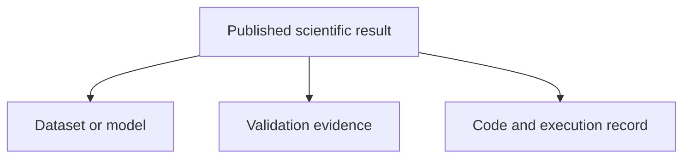
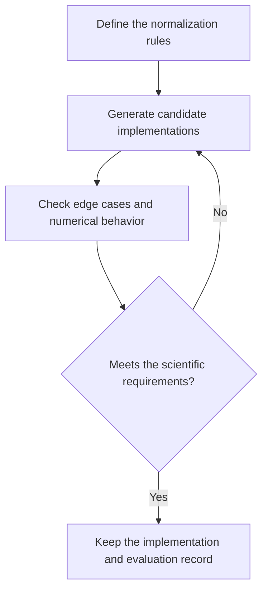
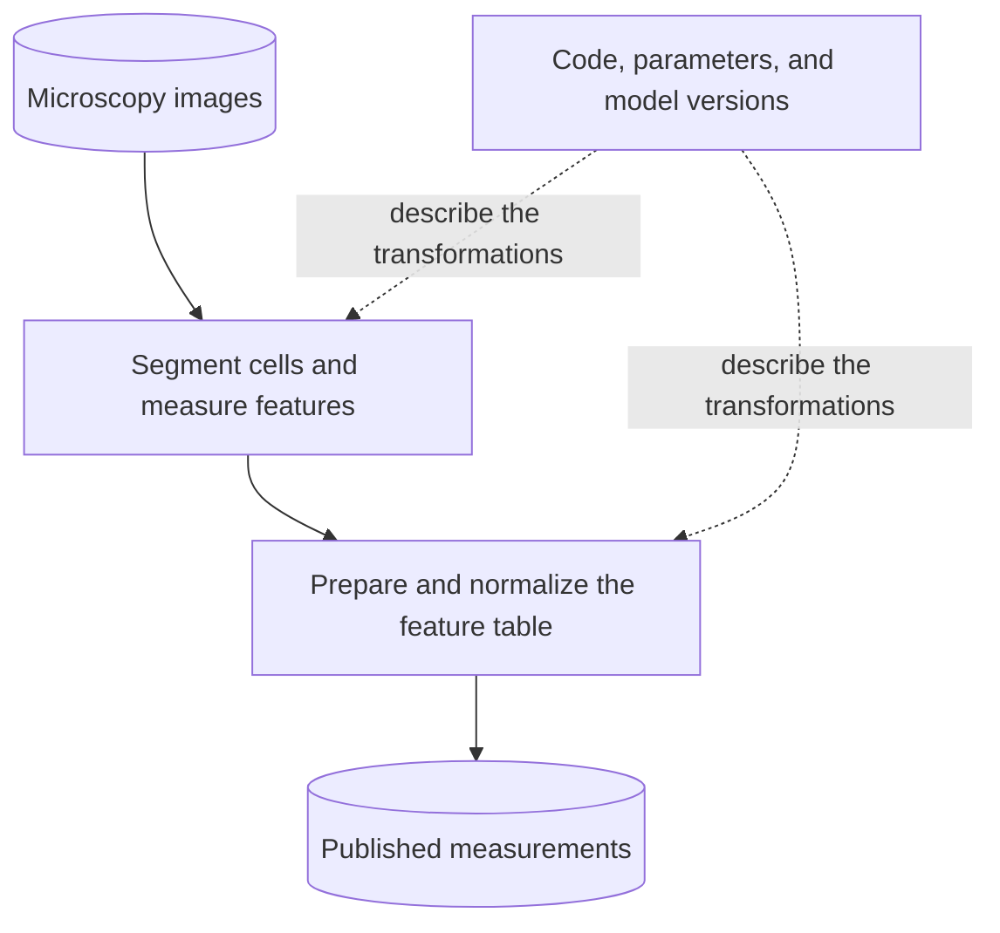
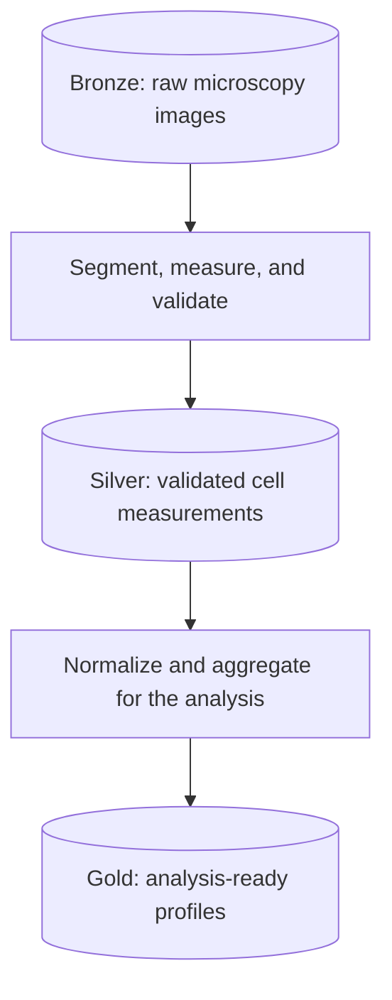
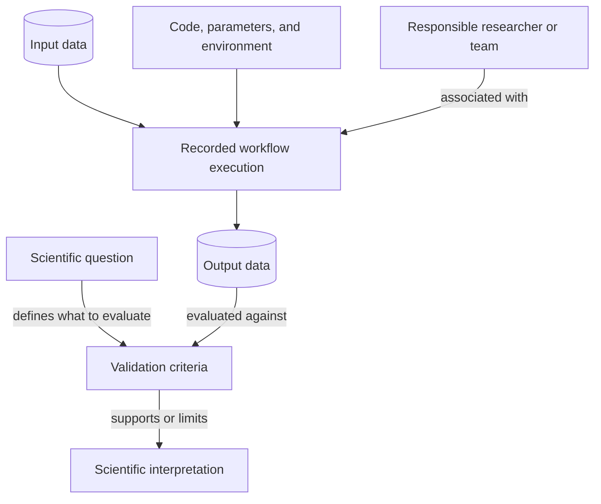
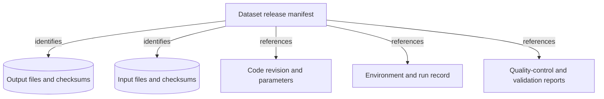
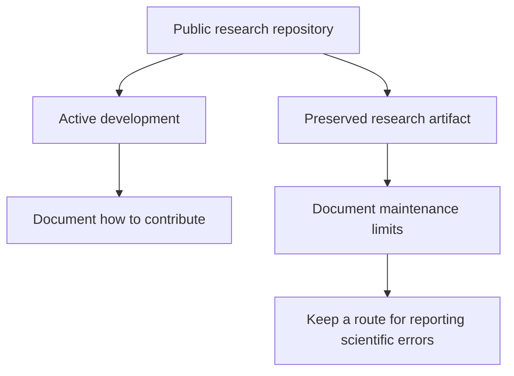
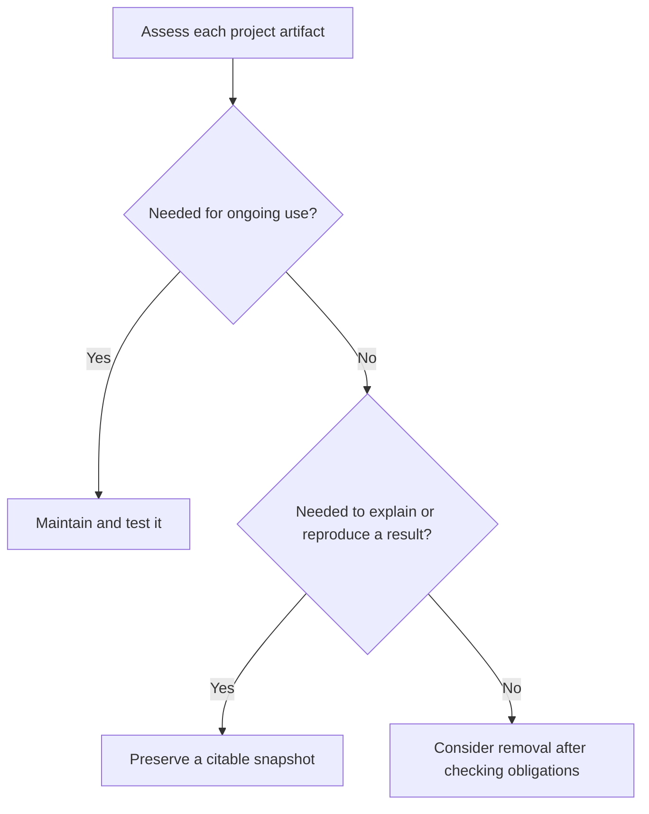
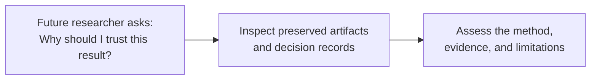

# When Code Becomes Metadata: Rethinking Research Software in the Age of AI



## Introduction



_A research result includes both the output and the information needed to interpret it._

<!-- excerpt start -->
**A research repository does not always represent a software product. Sometimes it preserves the method behind a dataset, model, or scientific finding.**
When code plays that supporting role, we can think of it as executable metadata: a method description that we can inspect and run.
That distinction helps us decide what to maintain, what to archive, and what evidence to preserve alongside our results.
<!-- excerpt end -->

Imagine publishing a table of measurements extracted from microscopy images.
A colleague asks how you produced it.
You send them the repository, but they still need to know which images you used, which parameters you selected, and whether the segmentation was any good.
The code answers part of their question. It does not answer all of it.
This is not a new problem created by AI. Sandve and colleagues' 2013 reproducibility guidance already called for recording inputs, parameters, software versions, and the steps connecting them to each result.[1]

In [Research Decision Engineering: Managing Cognitive Load in the Generative Era](https://bssw.io/items/research-decision-engineering-managing-cognitive-load-in-the-generative-era), I explored how generative tools change where we direct our engineering effort.
Software gardening still requires care, but more of that care may go toward framing problems and evaluating implementations.
Here, I want to extend that thinking to what we leave behind.
Using a microscopy workflow, we'll connect established data-oriented practices to preserving scientific intent, implementation, and evidence.

## Generating Code Is Only Part of the Work



_The evaluation loop remains necessary regardless of how we write the implementation._

An AI assistant can draft alternative image-normalization functions. That makes comparison easier, but does not establish suitability.

Suppose both produce similar-looking images, but one rescales each image independently while the other uses reference values from a control population.
Those are different scientific choices, even if both functions run without errors.
We also need to check constant-valued images, missing pixels, and the effect of converting integer values to floating point.

Keep the normalization rule, test cases, and selection rationale with the function, so a replacement can be evaluated against the same requirements.

The evidence cautions against a universal productivity claim.
A 2023 controlled experiment reported that developers with GitHub Copilot completed a JavaScript HTTP-server task 55.8% faster.[2]
A different 2025 trial found experienced developers took 19% longer on tasks in familiar open-source projects when AI tools were allowed.[3]
METR's February 2026 follow-up suggested greater benefits from newer tools, but warned that selection effects made the size of those benefits uncertain.[4]
These are different tasks and populations. Faster drafting, where it helps, still leaves evaluation and maintenance to do.

## Code as an Executable Methods Section



_Solid arrows show data processing. Dotted arrows show the information describing that processing._

Consider an image-based profiling workflow like those my colleagues and I work with in biomedical informatics.
[CellProfiler](https://github.com/CellProfiler/CellProfiler) can segment cells and measure their morphology.
[CytoTable](https://github.com/cytomining/CytoTable) can convert and join tabular outputs into Parquet, and [Pycytominer](https://github.com/cytomining/pycytominer) provides tools for processing morphological profiles.
The particular sequence depends on the analysis; these tools illustrate the different kinds of work involved.

For a dataset publication, measurements may be the primary contribution and code their executable methods section.
That supporting role does not make code less important: an error can undermine the dataset.

Execution still needs context: units, assumptions, input identities, and acceptance criteria.

The same software can occupy different roles in different projects:

| Project | Primary contribution | What to steward |
|---|---|---|
| Scientific library | A reusable implementation | Software, tests, releases, and documentation |
| Dataset publication | Measurements or derived data | Data and the method that produced it |
| Computational experiment | Findings and supporting evidence | Inputs, execution records, outputs, and interpretation |

CellProfiler itself can be a software research contribution, while a particular CellProfiler pipeline supports a dataset contribution.
A project can also contribute both software and data. We do not need to force it into one category.
The FAIR Principles for Research Software (FAIR4RS) reinforce this point: software needs distinct identifiers for its versions, a clear license, and its own provenance.[5]
Supporting a dataset does not exempt code from those responsibilities. We should identify and credit the implementation as well as the data it produced.

## Build on Data-Oriented Development



_An illustrative medallion layout for the microscopy workflow. The layers organize data refinement, not levels of scientific certainty._

This is not a new architecture.
The *medallion architecture*, documented by Databricks, organizes data into bronze (raw), silver (cleaned and validated), and gold (enriched, consumption-ready) layers.[11]
For our example, those roles can correspond to input images, checked cell measurements, and analysis-ready profiles.
The mapping is illustrative; it does not require Databricks or prescribe one processing sequence.
It makes the intermediate data products visible, giving us places to attach validation and provenance.
A gold-layer label alone does not establish scientific validity.

*Data-oriented programming* offers a complementary perspective at the program level.
Yehonathan Sharvit's formulation separates code from data, uses generic data structures, treats data as immutable, and separates schemas from representations.[12]
For our workflow, that suggests defining the feature table's schema, units, and acceptance tests independently of a particular implementation.
We can then compare replacement implementations against the same data contract.

Related *data-oriented design*, described by Richard Fabian, emphasizes data transformations and working with the hardware's characteristics.[13]
Its design and performance concerns are distinct from provenance or preservation policy.

I explored the testing side in [Data Quality Validation through Software Testing Techniques](https://cu-dbmi.github.io/set-website/2023/10/04/Data-Quality-Validation.html).
The connection here is straightforward: preserve the data contracts and checks alongside the transformation code.
AI changes how we may produce implementations; these established practices help us decide what those implementations must preserve.

## Keep Purpose Separate from Execution



_Execution produces an output; validation determines what we can reasonably conclude from it._

Separate scientific purpose from execution: the question defines what we want to learn; the run record describes what happened; validation supports interpretation.
Preserve these records and their relationships.

W3C's PROV model offers an established vocabulary: *entities* such as images and tables, *activities* such as a segmentation run, and *agents* such as the responsible researcher or organization.[6]
That last category matters. Provenance includes responsibility, not merely a chain of files.
It records what happened; our validation evidence addresses whether the result is fit for the scientific purpose.

To compare morphology across treatments, a completed feature table is insufficient.
We need evidence about segmentation, missing measurements, and whether normalization preserves relevant variation.

Two pipelines can share a purpose without producing identical results.
Any equivalence claim needs a scope: agreement within a specified tolerance on representative inputs, for example.
One passing plate is not universal evidence. Preserve the benchmark inputs, acceptance criteria, and comparison report.

## Version the Result and Its Provenance



_A release manifest connects the exact artifacts associated with a published dataset._

Git remains useful here.
It can version code, parameters, documentation, and provenance manifests.
What a code revision alone cannot tell us is which execution produced a particular dataset, especially when the same revision runs with different inputs or settings.
Versioning a workflow and recording a workflow run are different jobs.

For a small team, a starting point is a manifest attached to each dataset release:

```yaml
# Illustrative placeholders, not a provenance standard.
artifact:
  name: single-cell-morphology-features
  version: "1.0"
  files: "outputs-with-checksums.csv"

inputs:
  manifest: "input-images-with-checksums.csv"

implementation:
  repository: "https://github.com/example/analysis"
  revision: "<full-commit-id>"
  workflow: "extract_features.py"

execution:
  run_id: "<recorded-run-id>"
  responsible_agent: "<researcher-or-team-identifier>"
  environment: "container-image@sha256:<digest>"
  parameters: "parameters.yaml"

validation:
  report: "quality-control.json"
  acceptance_criteria: "validation-plan.md"
```

The referenced files must be preserved too; a filename is not a preservation strategy.
Record random seeds when applicable, and document manual preprocessing that the workflow cannot otherwise capture.[1]
Checksums help identify exact contents, but cannot recover missing files or establish scientific correctness.
Likewise, a container helps record the software environment without guaranteeing that a future machine will reproduce every numerical result.

Existing approaches can organize these relationships without a custom schema.
[RO-Crate](https://www.researchobject.org/ro-crate/) describes research artifacts and their relationships using structured metadata.
[Workflow Run RO-Crate](https://www.researchobject.org/workflow-run-crate) adds descriptions of executions, including inputs and outputs.
Its *Process Run Crate* profile can describe tools run manually in sequence; a team does not need a workflow engine to use that profile.[10]
[Software Heritage](https://www.softwareheritage.org/) complements these approaches by archiving source code with content-based identifiers.

Large data files can live in an appropriate data archive or object store while Git holds the human-authored records.
Whichever tools we choose, the goal is to keep those references resolvable and the artifacts accessible.
FAIR's accessibility principle A2 goes further: metadata should remain accessible even if the data are no longer available.[7]
For this dataset, that suggests keeping the release description and provenance independently discoverable, rather than storing their only copy beside the large data files.

## Public Code Does Not Promise Indefinite Maintenance



_Public access and maintenance commitments are separate decisions._

A completed analysis can remain useful without becoming a general-purpose library.
State its maintenance status rather than leaving readers to infer it from the last commit date.

I initially considered calling these *dark repositories*, but the preservation community already uses *dark archive* for restricted-access storage, as Portico illustrates.[8]
That is the opposite of the public readability intended here. *Public preservation repository* is a clearer description for a completed analysis.
Contribution policy remains a separate choice: a team can close external contributions while continuing internal work, or preserve a snapshot while accepting corrections elsewhere.

GitHub's [February 2026 announcement](https://github.blog/changelog/2026-02-13-new-repository-settings-for-configuring-pull-request-access) introduced settings to disable pull requests or restrict their creation to collaborators.
The [documentation](https://docs.github.com/en/repositories/managing-your-repositorys-settings-and-features/enabling-features-for-your-repository/disabling-pull-requests) describes these controls.
Disabling pull requests also hides existing ones, so preserve any review discussion needed to understand the published analysis before doing that.

A README should state what the repository supports, whether dependencies will receive updates, and how to report an error affecting the science.
Include a license and instructions for the preserved analysis.
The 2026 *CODE beyond FAIR* roadmap explicitly recommends stating whether contributions are accepted and describing maintenance and support limits.[9]
It also distinguishes a development platform from a dedicated archive. Keeping a repository public is useful, but is not by itself a long-term preservation commitment.[9]
Closing contributions cannot establish reproducibility, and it should not remove the path for correcting a published result.
For a community library, accepting and reviewing contributions may remain essential to its purpose.

## Decide What to Maintain, Preserve, or Remove



_Apply this decision to individual artifacts. A project can need both maintained software and preserved snapshots._

Start with a concrete sentence: "The contribution of this project is ..."
If the answer is a library, plan for tests, releases, documentation, and maintenance.
If it is a dataset, give the dataset its own release identity and preserve the code and evidence associated with that release.
A completed experiment needs its execution record and interpretation, even if nobody intends to run it again.

Decide artifact by artifact: maintain a shared normalization library while preserving the exact version used for a publication.

AI-generated code deserves the same assessment as handwritten code.
Temporary exploration can be discarded only after checking whether it explains a reported finding, an important exclusion, or a choice of method.
Institutional retention rules and agreements may impose additional requirements.
Do not assume a future model can regenerate the implementation that produced today's result.

## Knowledge Stewardship in Practice



_The preservation test is whether a future researcher can assess the result, not simply download its code._

Research decision engineering asks us to direct our attention toward consequential choices.
Knowledge stewardship carries those choices forward: which implementation we selected, what evidence justified it, and where its limits lie.

For the microscopy dataset, preserve enough to trace a measurement to its inputs and method, inspect quality control, and understand normalization decisions.
That requires care about what gets lost, not turning every script into a maintained package.

My suggested starting point is modest: identify the contribution, publish a release manifest, and write down the maintenance boundary.
Use existing provenance tools where they fit.
The goal is a collection of artifacts that lets another researcher understand and evaluate the science, with code preserved in the role it actually plays.

## Sources

[1] [Sandve et al. (2013). Ten Simple Rules for Reproducible Computational Research](https://journals.plos.org/ploscompbiol/article?id=10.1371/journal.pcbi.1003285)

[2] [Peng et al. (2023). The Impact of AI on Developer Productivity: Evidence from GitHub Copilot](https://arxiv.org/abs/2302.06590)

[3] [Becker et al. (2025). Measuring the Impact of Early-2025 AI on Experienced Open-Source Developer Productivity](https://arxiv.org/abs/2507.09089)

[4] [METR (2026). We are Changing our Developer Productivity Experiment Design](https://metr.org/blog/2026-02-24-uplift-update)

[5] [Barker et al. (2022). Introducing the FAIR Principles for research software](https://www.nature.com/articles/s41597-022-01710-x)

[6] [W3C (2013). PROV Model Primer](https://www.w3.org/TR/prov-primer)

[7] [Wilkinson et al. (2016). The FAIR Guiding Principles for scientific data management and stewardship](https://www.nature.com/articles/sdata201618)

[8] [Portico. For participants: access to a dark preservation archive](https://www.portico.org/for-participants)

[9] [Di Cosmo et al. (2026). CODE beyond FAIR: a roadmap for reusable research software](https://www.nature.com/articles/s41597-026-06705-6)

[10] [Leo et al. (2024). Recording provenance of workflow runs with RO-Crate](https://journals.plos.org/plosone/article?id=10.1371/journal.pone.0309210)

[11] [Databricks. What is the medallion lakehouse architecture?](https://docs.databricks.com/gcp/en/lakehouse/medallion)

[12] [Sharvit (2022). Separate data schema from data representation](https://blog.klipse.tech/databook/2022/06/22/data-validation.html)

[13] [Fabian. Data-Oriented Design: data, transformations, and hardware](https://www.dataorienteddesign.com/dodbook/node2.html)
