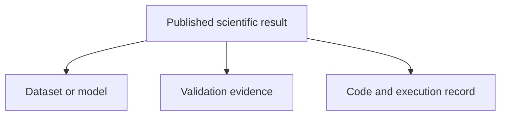
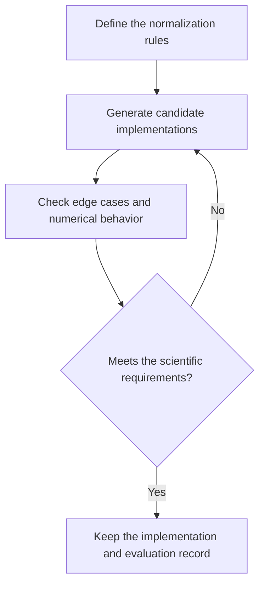
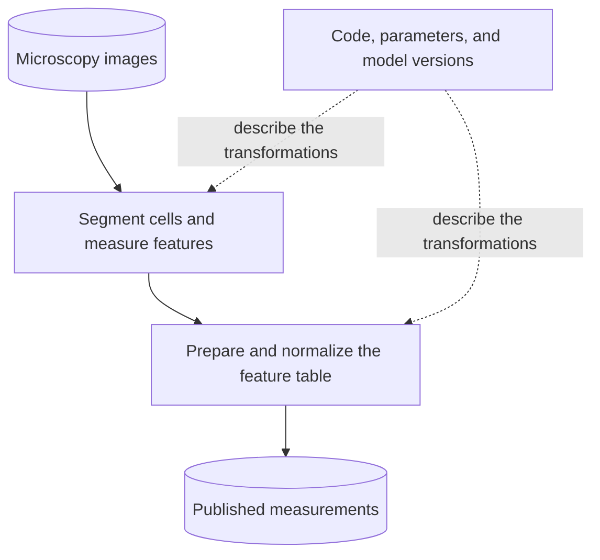
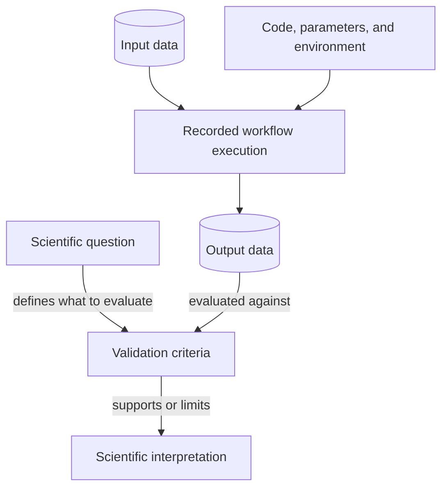
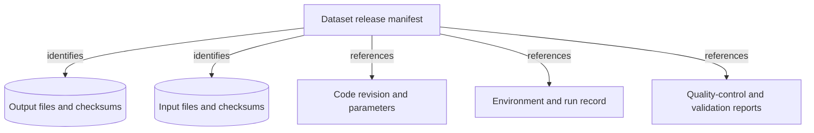
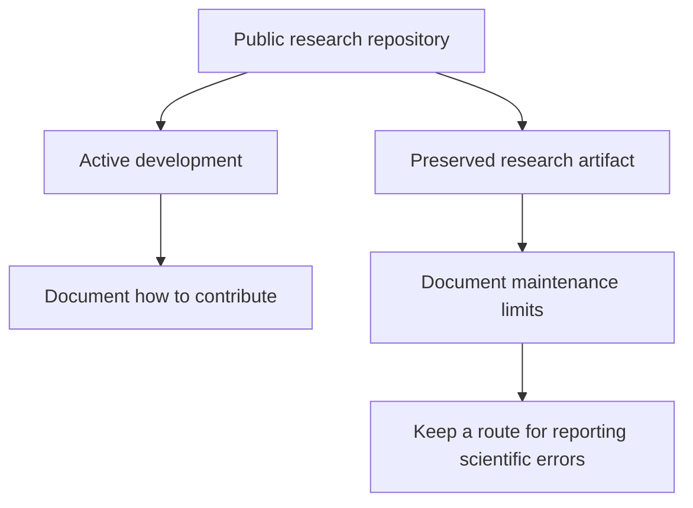
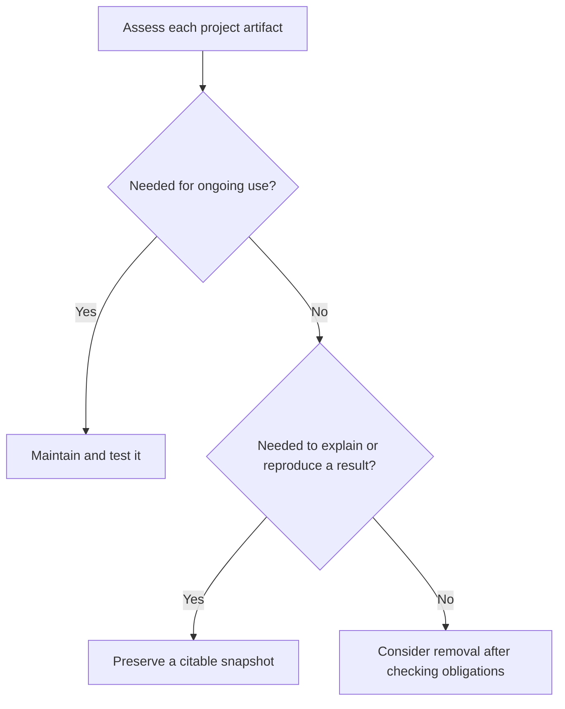
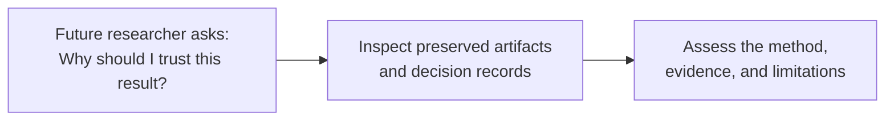

# When Code Becomes Metadata: Rethinking Research Software in the Age of AI



## Introduction



_A research result includes both the output and the information needed to interpret it._

<!-- excerpt start -->
**A research repository does not always represent a software product. Sometimes it preserves the method behind a dataset, model, or scientific finding.**
When code plays that supporting role, we can think of it as executable metadata: a method description that we can inspect and run.
That distinction helps us decide what to maintain, what to archive, and what evidence to preserve alongside our results.
<!-- excerpt end -->

Imagine publishing a table of measurements extracted from microscopy images.
A colleague asks how you produced it.
You send them the repository, but they still need to know which images you used, which parameters you selected, and whether the segmentation was any good.
The code answers part of their question. It does not answer all of it.

In [Research Decision Engineering: Managing Cognitive Load in the Generative Era](https://bssw.io/items/research-decision-engineering-managing-cognitive-load-in-the-generative-era), I explored how generative tools change where we direct our engineering effort.
Software gardening still requires care, but more of that care may go toward framing problems and evaluating implementations.
Here, I want to extend that thinking to what we leave behind.
Using a microscopy workflow as an example, we'll consider how to preserve the relationship between scientific intent, implementation, and evidence.

## Generating Code Is Only Part of the Work



_The evaluation loop remains necessary regardless of how we write the implementation._

An AI assistant can help draft several ways to normalize an image: perhaps one using NumPy and another using an image-processing library.
That makes comparison easier to attempt. It does not establish that either candidate is suitable for the analysis.

Suppose both produce similar-looking images, but one rescales each image independently while the other uses reference values from a control population.
Those are different scientific choices, even if both functions run without errors.
We also need to check constant-valued images, missing pixels, and the effect of converting integer values to floating point.

The useful artifact is therefore more than the selected function.
It includes the normalization rule, the test cases, and the reason for selecting that implementation.
If a future developer replaces the function, that record gives them something meaningful to evaluate against.

I would avoid treating faster code generation as a universal productivity claim.
Its value depends on the task and the review it requires.
The narrower argument is enough: when generating candidates becomes easier, we still have to decide which ones deserve our trust and maintenance time.
A script written quickly can create years of dependency updates and support work.

## Code as an Executable Methods Section



_Solid arrows show data processing. Dotted arrows show the information describing that processing._

Consider an image-based profiling workflow like those my colleagues and I work with in biomedical informatics.
[CellProfiler](https://github.com/CellProfiler/CellProfiler) can segment cells and measure their morphology.
[CytoTable](https://github.com/cytomining/CytoTable) can convert and join tabular outputs into Parquet, and [Pycytominer](https://github.com/cytomining/pycytominer) provides tools for processing morphological profiles.
The particular sequence depends on the analysis; these tools illustrate the different kinds of work involved.

For a dataset publication, the measurements may be the primary contribution.
The analysis code explains how those measurements were produced.
Calling it *executable metadata* describes that relationship, rather than suggesting the code is less important.
An error in the supporting code can still undermine the entire dataset.

A methods section describes a procedure in words.
Code describes part of that procedure in executable form, but it still needs context: units, assumptions, input identities, and the conditions under which we consider an output acceptable.

The same software can occupy different roles in different projects:

| Project | Primary contribution | What to steward |
|---|---|---|
| Scientific library | A reusable implementation | Software, tests, releases, and documentation |
| Dataset publication | Measurements or derived data | Data and the method that produced it |
| Computational experiment | Findings and supporting evidence | Inputs, execution records, outputs, and interpretation |

CellProfiler itself can be a software research contribution, while a particular CellProfiler pipeline supports a dataset contribution.
A project can also contribute both software and data. We do not need to force it into one category.

## Keep Purpose Separate from Execution



_Execution produces an output; validation determines what we can reasonably conclude from it._

A useful artifact model separates scientific purpose from the mechanics of running software.
The question tells us what we want to learn.
The execution record tells us what happened.
Validation connects the output to the question, and interpretation explains what the evidence supports.
Storage and versioning help preserve all of these records and their relationships.

For the microscopy example, suppose we want to compare cellular morphology across treatments.
A successful run that produces a feature table is necessary, but insufficient.
We also need evidence about segmentation quality, missing measurements, and whether normalization preserves the variation relevant to the comparison.

This distinction matters when replacing an implementation.
Two pipelines can share a scientific purpose without producing identical results.
If we call them equivalent, we should state the scope of that claim: perhaps they agree within a specified tolerance on a representative benchmark, or preserve a particular downstream result.
A passing comparison on one plate does not establish equivalence for every future image.
Keep the benchmark inputs, acceptance criteria, and comparison report alongside the implementation references.

## Version the Result and Its Provenance



_A release manifest connects the exact artifacts associated with a published dataset._

Git remains useful here.
It can version code, parameters, documentation, and provenance manifests.
What a code revision alone cannot tell us is which execution produced a particular dataset, especially when the same revision runs with different inputs or settings.
Versioning a workflow and recording a workflow run are different jobs.

For a small team, a starting point is a manifest attached to each dataset release:

```yaml
# Illustrative placeholders, not a provenance standard.
artifact:
  name: single-cell-morphology-features
  version: "1.0"
  files: "outputs-with-checksums.csv"

inputs:
  manifest: "input-images-with-checksums.csv"

implementation:
  repository: "https://github.com/example/analysis"
  revision: "<full-commit-id>"
  workflow: "extract_features.py"

execution:
  run_id: "<recorded-run-id>"
  environment: "container-image@sha256:<digest>"
  parameters: "parameters.yaml"

validation:
  report: "quality-control.json"
  acceptance_criteria: "validation-plan.md"
```

The referenced files must be preserved too; a filename is not a preservation strategy.
Checksums help identify exact contents, but cannot recover missing files or establish scientific correctness.
Likewise, a container helps record the software environment without guaranteeing that a future machine will reproduce every numerical result.

Existing approaches can organize these relationships without a custom schema.
[RO-Crate](https://www.researchobject.org/ro-crate/) describes research artifacts and their relationships using structured metadata.
[Workflow Run RO-Crate](https://www.researchobject.org/workflow-run-crate) adds descriptions of executions, including inputs and outputs; its [research paper](https://arxiv.org/abs/2312.07852) explains the profiles and implementations.
[Software Heritage](https://www.softwareheritage.org/) complements these approaches by archiving source code with content-based identifiers.

Large data files can live in an appropriate data archive or object store while Git holds the human-authored records.
Whichever tools we choose, the goal is to keep those references resolvable and the artifacts accessible.

## Public Code Does Not Promise Indefinite Maintenance



_Public access and maintenance commitments are separate decisions._

A completed analysis does not necessarily need to become a general-purpose library.
Its repository may remain useful for inspection and reuse even after active development ends.
We should make that status explicit rather than leaving readers to infer it from the last commit date.

I'll use *dark repository* here as a proposed label for publicly readable code with an intentionally closed external contribution workflow.
It is not an established repository category, and it does not mean closed source.
It is also different from archiving: a team might close external contributions while continuing internal work.
An archival repository preserves a completed state; a contribution policy controls who can propose changes.

GitHub's [February 2026 announcement](https://github.blog/changelog/2026-02-13-new-repository-settings-for-configuring-pull-request-access) introduced settings to disable pull requests or restrict their creation to collaborators.
The [documentation](https://docs.github.com/en/repositories/managing-your-repositorys-settings-and-features/enabling-features-for-your-repository/disabling-pull-requests) describes these controls.
Disabling pull requests also hides existing ones, so preserve any review discussion needed to understand the published analysis before doing that.

A README should state what the repository supports, whether dependencies will receive updates, and how to report an error affecting the science.
Include a license and instructions for the preserved analysis.
Closing contributions cannot establish reproducibility, and it should not remove the path for correcting a published result.
For a community library, accepting and reviewing contributions may remain essential to its purpose.

## Decide What to Maintain, Preserve, or Remove



_Apply this decision to individual artifacts. A project can need both maintained software and preserved snapshots._

Start with a concrete sentence: "The contribution of this project is ..."
If the answer is a library, plan for tests, releases, documentation, and maintenance.
If it is a dataset, give the dataset its own release identity and preserve the code and evidence associated with that release.
A completed experiment needs its execution record and interpretation, even if nobody intends to run it again.

Then make the decision artifact by artifact.
A shared normalization library may need ongoing maintenance while the exact version used for a publication needs an immutable snapshot.
Those are compatible responsibilities.

AI-generated code deserves the same assessment as handwritten code.
Temporary exploration can be discarded only after checking whether it explains a reported finding, an important exclusion, or a choice of method.
Institutional retention rules and agreements may impose additional requirements.
Do not assume a future model can regenerate the implementation that produced today's result.

## Knowledge Stewardship in Practice



_The preservation test is whether a future researcher can assess the result, not simply download its code._

Research decision engineering asks us to direct our attention toward consequential choices.
Knowledge stewardship carries those choices forward: which implementation we selected, what evidence justified it, and where its limits lie.

For the microscopy dataset, that means preserving enough for someone to trace a measurement back to its inputs and method, inspect the quality-control results, and understand the normalization decision.
It does not require turning every script into a maintained package.
It does require care about what gets lost when the analysis ends.

My suggested starting point is modest: identify the contribution, publish a release manifest, and write down the maintenance boundary.
Use existing provenance tools where they fit.
The goal is a collection of artifacts that lets another researcher understand and evaluate the science, with code preserved in the role it actually plays.
